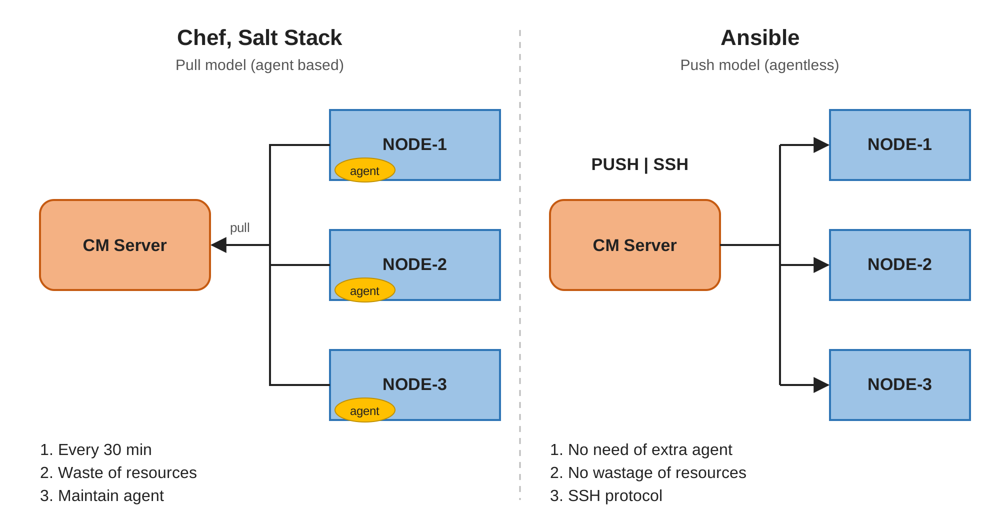

# Ansible

> Ansible is a configuration management and automation tool that helps transform a plain server into an     application-ready server by installing the required software, configuring services, and deploying applications.

**Using Ansible, you can automatically:**
- Install required packages.
- Install Java, Python, or Nginx.
- Create users and directories.
- Configure services.
- Copy application files.
- Start and enable services.
- Configure required settings.

**Push V/S Pull**

**Push:** The control node sends configurations to target servers.
**Pull:** Target servers retrieve configurations from a central location.
**Important:** Ansible normally uses the Push model. Ansible also supports the Pull model through ansible-pull.

**Ansible Pull & Push**


---------------


**Ansible Adhoc-Commands:**
- Adhoc command = Execute a quick task.
- Ansible Adhoc Commands are used to execute simple tasks on servers without writing a playbook.
```
ansible all -i 172.168.0.1, -e "ansible_user=ec2-user ansible_password=DevOps321" -m ping
```
```
ansible all -i 172.168.0.1, -e "ansible_user=ec2-user ansible_password=DevOps321" -b -m dnf -a "name=nginx state=present"
```
```
ansible all -i 172.168.0.1, -e "ansible_user=ec2-user ansible_password=DevOps321" -b -m service -a "name=nginx state=started"
```
- all → All servers
- -i → Inventory (server IP)
- -e → Extra variables (username and password)
- -m ping → Check connectivity
- -b → Run with sudo privileges
- -m dnf → Install packages
- -a → Module arguments
- state=present → Ensure Nginx is installed

**Playbook**\n
When we have repetitive tasks, we write all the tasks using Ansible modules in a file called a Playbook.
Playbook = Automate multiple tasks using a YAML file.

YAML → Yet Another Markup Language
HTML → HyperText Markup Language
XML → eXtensible Markup Language
JSON → JavaScript Object Notation